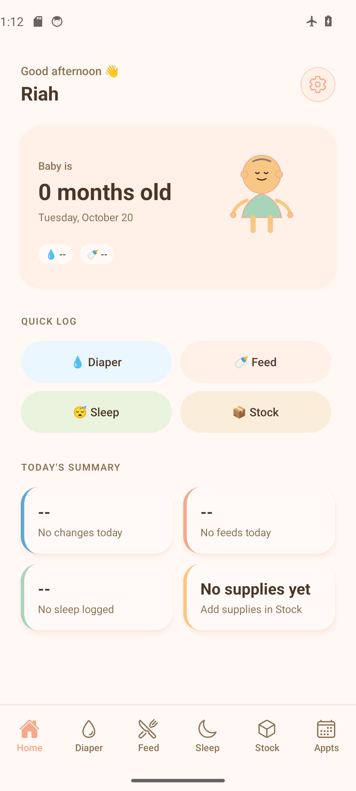
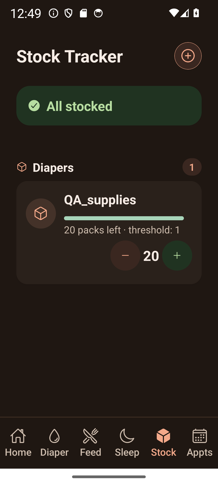

<p align="center">
  
</p>

# Riah

A baby-care tracker for feeding, sleep, diaper changes, supplies, and appointments. Built with React Native, Expo, TypeScript, and SQLite.

Riah keeps the day's care records together without requiring an account or a network connection. The interface uses warm colors, large logging controls, and a night theme for late check-ins.

<p align="center">
  
  
</p>

_Android 14 emulator screenshots with synthetic data. The supply screen uses 130% system text size._

## Features

- **Feeding:** left/right breastfeeding timers, bottle amounts in ml or oz, and solids.
- **Sleep:** nap and night sessions, a daily timeline, and timers that recover after the app closes.
- **Diapers:** wet, dirty, and mixed changes with notes and daily totals.
- **Supplies:** quantities, units, low-stock thresholds, and quick adjustments.
- **Appointments:** checkups, vaccine details, editing, and scheduled local reminders.
- **Home:** profile, recent care activity, daily summaries, and tracker shortcuts.

## Engineering

- SQLite is the source of truth for care records and the active sleep session. Schema migrations add fields without rebuilding user tables.
- Timer durations come from saved timestamps, so suspending JavaScript does not discard elapsed time.
- Feeding and sleep session IDs prevent duplicate records when a save is retried. Stock changes use atomic SQL deltas.
- Validation lives at the database boundary. Shared action hooks handle pending states, errors, and deletion confirmation.
- Local reminders are reconciled with the OS scheduler rather than simulated by foreground polling.

See [architecture](docs/ARCHITECTURE.md) for the data flow and tradeoffs.

## Run locally

Use Node 24 and npm. No backend credentials or environment file are required.

```sh
npm ci
npm run check
npm start
```

For an Android development build, configure the Android SDK and JDK, connect a device or start an emulator, then run:

```sh
npm run android -- --device
```

For the browser preview:

```sh
npm run web
```

SQLite on web needs cross-origin isolation headers. The [development guide](docs/DEVELOPMENT.md) covers setup, previewing an export, and troubleshooting. The [APK guide](docs/ANDROID_INSTALL.md) explains standalone installation and local builds.

## Verification

`npm run check` runs strict TypeScript checking and 15 regression tests covering migrations, failed writes, daily totals, timer recovery, duplicate saves, inventory updates, and reminder scheduling. `npm run export:web` checks the web bundle. GitHub Actions runs both on pushes and pull requests.

The standalone Android test APK has been installed and cold-started in airplane mode. Emulator checks also cover native date dialogs, keyboard access, timer restoration after force-stop, and narrow layouts with enlarged text. Results and remaining cases are in the [testing guide](docs/testing/README.md).

## Status

Riah is a working prototype, not a production release. Remaining work includes physical-device acceptance, notification delivery, accessibility, backup/recovery, and dependency security fixes. See the [roadmap](docs/ROADMAP.md) and [dependency review](docs/RIAH_DEPENDENCY_SECURITY.md).

Records stay in local SQLite; preferences and breastfeeding timer state use AsyncStorage. There is no account system, partner sync, cloud backup, or in-app database encryption.

## Project structure

```text
app/          Routes and tracker screens
components/   Shared UI
hooks/        Actions, timers, and confirmation
db/           Schema, migrations, and record operations
services/     Notifications and data-change events
utils/        Validation, dates, and care rules
tests/        Regression tests with disposable data
docs/         Setup, architecture, and test evidence
```

[Contributing](CONTRIBUTING.md) · [Security](SECURITY.md) · [Changelog](CHANGELOG.md) · [Documentation](docs/README.md)

No license has been selected yet.
