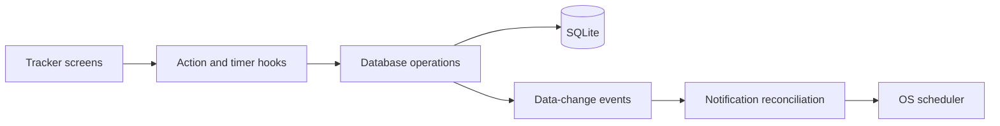

# Architecture

Riah is a local-first Expo Router app. `expo-router/entry` loads `app/_layout.tsx`, which initializes SQLite, restores the profile, handles notification routes, and mounts the screens inside the theme provider.

## Data flow

`db/database.ts` owns parameterized record operations and validates writes through `utils/care.ts`. `db/schema.ts` applies additive migrations in a transaction and refuses unsupported future schemas. SQLite stores the profile, care logs, appointments, inventory, and active sleep session. AsyncStorage stores preferences, breastfeeding session state, and reminder metadata.

Screens refresh on focus and after relevant actions. Data-change events update shared indicators and request reminder reconciliation. Loading and error states remain visible when reads or writes fail.

## Timers and retries

Sleep uses a persisted active session. Stopping it writes the completed log and clears the active session transactionally. Breastfeeding stores accumulated duration and running timestamps. Both calculate elapsed wall time when the app resumes.

Unique session IDs make repeated saves safe. Stock quantities change with `quantity + delta` in SQL instead of replacing a potentially stale value from the UI. Appointment edits preserve the existing row ID.

Daily aggregates query the full local day, independently of the bounded recent-history lists. Sleep totals clip intervals to that day's boundaries. Birthdates are civil `YYYY-MM-DD` dates, not UTC timestamps.

## Reminders

`services/notifications.ts` serializes reconciliation against scheduled local notifications. It schedules appointment offsets, care reminders, and low-stock notices; removes obsolete requests; and limits pending schedules. Permission is requested from Settings. Notification routes are allowlisted at startup.

Automated tests verify scheduling decisions and failures. Actual delivery still depends on permissions and Android/iOS background behavior and needs device acceptance.

## Tradeoffs

- Keeping records local avoids account and server dependencies, but there is no cross-device sync or recovery after uninstall.
- SQLite provides transactional writes; AsyncStorage remains suitable for small preferences and timer metadata, rather than relational records.
- The web target is useful for UI checks, but cannot validate native permissions, background execution, or notification delivery.
- Recent lists are intentionally bounded. Full-history browsing and export remain planned work.

## Tests

The Node test harness transpiles the actual TypeScript modules and runs database logic against disposable in-memory SQLite. Storage and notification APIs are mocked to test failure and retry behavior. A focused screen harness checks inventory loading. Native evidence and untested cases are indexed in [testing](testing/README.md).
